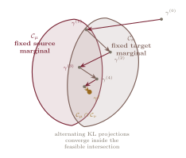

## Schrödinger's Lazy Particles

In the early 1930s, Erwin Schrödinger posed a puzzle [@schrodinger1931; @schrodinger1932]. Imagine a large collection of Brownian particles---dust motes undergoing free diffusion---observed at two moments in time. At $t=0$, their positions follow a distribution $\mu$. At $t=1$, they follow another distribution $\nu$. If the final arrangement is very different from what free diffusion would ordinarily produce, something unusual must have happened. But what?

Schrödinger's question was not about the most probable path of one particle. It concerned the most probable *ensemble* of paths: among all stochastic evolutions consistent with both endpoint observations, which entire movie is least surprising relative to free diffusion?

The answer is the *Schrödinger bridge*. It matches the observed endpoint distributions while deviating as little as possible from a chosen reference process. In this sense, the particles are lazy. Given that they must begin at $\mu$ and end at $\nu$, they collectively take the least surprising route allowed by the reference dynamics.

This framing matters. The bridge is not a geometric construction imposed from outside; it is an inference problem on path space. The endpoint distributions are the observations, the reference diffusion is the prior dynamics, and the bridge is the most plausible stochastic explanation connecting them.

There is a precise large-sample meaning behind the phrase *most plausible*. Imagine $N$ independent particles following the reference dynamics, and form their empirical path measure $L_N=N^{-1}\sum_{i=1}^N\delta_{X^{(i)}}$. Condition on the rare event that the empirical endpoint distributions are close to $\mu$ and $\nu$. A Sanov-type large-deviation principle says that, as $N\to\infty$, the conditional empirical path measure concentrates on the feasible law with the smallest relative entropy to the reference [@leonard2014]. Thus the “most probable ensemble” is not the mode of a single continuous trajectory; it is the large-particle limit of a conditioned empirical law.

## Stochastic Optimal Transport

The [previous post](../the-asymmetry-of-information/) introduced the bridge as a path-space KL projection. We can now make that statement precise and connect it to the Benamou--Brenier picture from the [second post](../the-second-ruler-of-displacement/).

Let $\Omega=C([0,1],\mathbb R^d)$ be the space of continuous paths, and let $X_t(\omega)=\omega_t$ denote the position of a path $\omega\in\Omega$ at time $t$. Write $\mathbb R^\varepsilon$ for a Brownian probability law with initial marginal $r_0$ and noise level $\varepsilon>0$,

$$
dX_t=\sqrt{\varepsilon}\,dB_t,
$$ {#eq-brownian-reference}

where $B_t$ is standard Brownian motion. Choosing $r_0=\mu$ builds the initial constraint into the reference. More generally, $r_0$ may differ from $\mu$, in which case the entropy objective also accounts for the initial mismatch. We will introduce the related reversible-reference convention separately when it gives a cleaner form of the Schrödinger system.

For a path measure $\mathbb P$, let $\mathbb P_t=(X_t)_\#\mathbb P$ be its marginal at time $t$, where $\#$ denotes pushforward of a measure. The Schrödinger bridge from $\mu$ to $\nu$ relative to $\mathbb R^\varepsilon$ is

$$
\mathbb P^\varepsilon
=
\operatorname*{arg\,min}_{\substack{
\mathbb P:\;\mathbb P_0=\mu,\\
\mathbb P_1=\nu
}}
\operatorname{KL}\!\left(\mathbb P\middle\|\mathbb R^\varepsilon\right).
$$ {#eq-schrodinger-bridge}

Here $\operatorname{KL}(\mathbb P\|\mathbb R^\varepsilon)$ compares probability laws on *whole trajectories*, not merely their time slices. Under suitable integrability and positivity assumptions, the minimizer exists and is unique [@leonard2014].

In the regular Euclidean quadratic-cost setting, where a Brenier map exists and induces the displacement interpolation, the structural comparison is:

::: {.compact-table .wide-table .label-first-column}

| Aspect | Benamou--Brenier | Schrödinger bridge |
|---|---|---|
| Object | Density path $\rho_t$ and velocity $v_t$ | Path measure $\mathbb P$ |
| Cost | Kinetic action $\int_0^1\!\int \lVert v_t\rVert^2\rho_t\,dx\,dt$ | Path-space $\operatorname{KL}(\mathbb P\|\mathbb R^\varepsilon)$ |
| Reference behavior | Straight characteristics induced by the optimal map | Brownian diffusion |
| Dynamics | Deterministic continuity equation | Controlled stochastic diffusion |
| Noise | None | $\varepsilon>0$ |
| Output | Displacement interpolation / optimal flow | Stochastic path ensemble |
| Small-noise behavior | Already deterministic | Approaches quadratic optimal transport |

: Deterministic and stochastic formulations of transport. {#tbl-deterministic-stochastic-transport}

:::

Both problems seek the least costly movie connecting $\mu$ to $\nu$. Benamou--Brenier minimizes kinetic energy among deterministic flows. The Schrödinger bridge minimizes information-theoretic deviation from a stochastic reference.

::: {.callout-tip .math-depth title="Mathematical Depth"}
***From path-space KL to control energy.*** Suppose a candidate process has the controlled dynamics

$$
dX_t=u_t\,dt+\sqrt{\varepsilon}\,dB_t,
$$ {#eq-controlled-diffusion}

where $u_t$ is an adapted drift. If the controlled process and the Brownian reference have the same initial law, Girsanov's theorem gives

$$
\operatorname{KL}\!\left(\mathbb P\middle\|\mathbb R^\varepsilon\right)
=
\frac{1}{2\varepsilon}
\mathbb E_{\mathbb P}
\left[
\int_0^1 \lVert u_t\rVert^2\,dt
\right].
$$ {#eq-girsanov-control-cost}

If their initial laws differ, an additional term $\operatorname{KL}(\mathbb P_0\|\mathbb R_0^\varepsilon)$ appears. The path-space KL objective is therefore a quadratic control-energy objective, scaled by the inverse noise level [@follmer1988; @leonard2014].

If $\rho_t$ is the density of $X_t$ and $u_t(x)$ is a Markov drift, then $\rho_t$ obeys the Fokker--Planck equation

$$
\partial_t\rho_t
+\nabla\cdot(\rho_tu_t)
=
\frac{\varepsilon}{2}\Delta\rho_t.
$$ {#eq-bridge-fokker-planck}

Compare this with the continuity equation from Benamou--Brenier. The right-hand side is exactly the diffusion that distinguishes stochastic transport from deterministic transport.

Here $\nabla\cdot$ is the spatial divergence and $\Delta=\nabla\cdot\nabla$ is the Laplacian.
:::

::: {.callout-note .remark-box title="Remark"}
***The zero-noise limit.*** As $\varepsilon\to0$, the Brownian fluctuations vanish and the entropic problem approaches quadratic optimal transport under appropriate assumptions [@leonard2014]. If $T$ is the Brenier map and $X_0\sim\mu$, the limiting path law is induced by the displacement characteristics

$$
X_t=(1-t)X_0+tT(X_0).
$$ {#eq-displacement-characteristics}

More precisely, the bridge measures concentrate on the ensemble of these paths. They do not converge to one delta mass on a single trajectory: different starting points $X_0$ still generate different characteristics.

Entropy regularization makes the finite-noise problem smoother and, under standard positivity conditions, strictly convex with a unique coupling. The deterministic Wasserstein geometry reappears when that regularization is removed.
:::

{#fig-bridge-paths width="92%" fig-alt="Space-time diagram with source and target distributions, faint Brownian paths, controlled bridge paths, and a deterministic optimal-transport characteristic."}

## Steering the Flow: The $(f,g)$-Transform

How does the bridge steer its particles? The answer is a two-sided change of measure known as the *$(f,g)$-transform*. It is the time-symmetric extension of the usual one-sided Doob $h$-transform: rather than conditioning only on a future event, it reweights reference paths according to their compatibility with both endpoint observations [@leonard2014].

Under standard assumptions, there are nonnegative endpoint potentials $f_0$ and $g_1$ such that

$$
\frac{d\mathbb P^\varepsilon}{d\mathbb R^\varepsilon}
=
f_0(X_0)\,g_1(X_1).
$$ {#eq-doob-density}

Their time-dependent versions are conditional expectations under the reference process,

$$
f_t(x)
=
\mathbb E_{\mathbb R^\varepsilon}
\!\left[f_0(X_0)\mid X_t=x\right],
\qquad
g_t(x)
=
\mathbb E_{\mathbb R^\varepsilon}
\!\left[g_1(X_1)\mid X_t=x\right].
$$ {#eq-schrodinger-potentials}

The first potential carries information from the initial endpoint forward; the second carries information from the terminal endpoint backward. If $\mathbb R_t^\varepsilon$ is the reference marginal at time $t$, their product gives the bridge marginal relative to that reference:

$$
\frac{d\mathbb P_t^\varepsilon}{d\mathbb R_t^\varepsilon}(x)
=
f_t(x)g_t(x).
$$ {#eq-bridge-density-factorization}

For a zero-drift Brownian reference, the forward bridge dynamics can be read as a Doob transform generated by $g_t$. Its drift is

$$
u_t^*(x)
=
\varepsilon\nabla_x\log g_t(x),
$$ {#eq-optimal-bridge-drift}

so the terminal constraint acts through the gradient of a log-potential. The time-reversed description uses the complementary potential $f_t$.

::: {.callout-tip .math-depth title="Mathematical Depth"}
***A score-like drift, with an important distinction.*** The vector $\nabla_x\log g_t(x)$ is a *spatial* logarithmic derivative: it tells us how the backward potential changes as the state $x$ moves. This makes it score-like, but it is not the same object as the parameter score $\partial_{\theta^i}\log p_\theta(x)$ from the Fisher metric.

Both are logarithmic derivatives, yet they differentiate with respect to different variables and serve different roles. The Fisher score measures sensitivity to a model parameter. The bridge gradient supplies a control direction in sample space. Their resemblance is structural, not an identity.
:::

::: {.callout-note .remark-box title="Remark"}
***Why the drift is a gradient.*** For a Brownian reference on Euclidean space, $u_t^*=\varepsilon\nabla\log g_t$ is the gradient of the scalar potential $\varepsilon\log g_t$. Wherever this potential is smooth, the drift is curl-free. Simple connectedness enters in the converse direction: on a simply connected domain, a sufficiently regular curl-free field admits a global scalar potential.

This statement depends on the reference dynamics and geometry. On a manifold, or in a domain with nontrivial topology or boundaries, the appropriate weighted Hodge decomposition must account for harmonic components and boundary conditions. We will return to that qualification at the end of the post.
:::

## The Schrödinger System

The two potentials are coupled by the requirement that the bridge have the correct marginals at both endpoints. For a general Markov reference, they propagate through its forward and backward transition operators.

To obtain the clean heat-system formulas below, specialize now to Brownian motion that is reversible with respect to a reference measure $m$. On a compact domain, $m$ can be normalized so that the reference is a probability law. On $\mathbb R^d$, the natural choice $m(dx)=dx$ gives a sigma-finite reversible path measure instead. In that case, the objective is understood as relative entropy with respect to a sigma-finite reference, rather than ordinary KL between two probability laws; the distinction affects normalization, not the bridge selected by the endpoint-constrained problem [@leonard2014].

Under this reversible Brownian convention, $f_t$ and $g_t$ propagate through the heat semigroup. In differential form,

$$
\partial_t f_t
=
\frac{\varepsilon}{2}\Delta f_t,
\qquad
-\partial_t g_t
=
\frac{\varepsilon}{2}\Delta g_t.
$$ {#eq-forward-backward-heat}

Writing the endpoint densities relative to $m$, set $g_0=P_1g_1$ and $f_1=P_1f_0$, where $P_t$ is the heat semigroup. The endpoint constraints become

$$
f_0(x)g_0(x)
=
\frac{d\mu}{dm}(x),
\qquad
f_1(x)g_1(x)
=
\frac{d\nu}{dm}(x).
$$ {#eq-schrodinger-system}

These equations form the *Schrödinger system*. We must find $f_0$ and $g_1$ whose forward and backward heat evolutions produce the prescribed products at both ends. It is a nonlinear fixed-point problem hidden inside two linear evolutions.

Under standard regularity and positivity assumptions, the bridge process is unique [@leonard2014]. The potentials themselves have one harmless ambiguity: multiplying $f$ by a positive constant and dividing $g$ by the same constant leaves every product $f_tg_t$ unchanged. They are therefore unique only up to reciprocal scaling.

That continuous system rarely has a closed-form solution. Its discrete analog, however, becomes one of the most useful algorithms in computational optimal transport.

## Sinkhorn as Alternating KL Projection

Suppose $\mu\in\mathbb R_+^n$ and $\nu\in\mathbb R_+^m$ are discrete probability vectors, and $C_{ij}$ is the cost of moving mass from source point $i$ to target point $j$. Entropically regularized optimal transport solves

$$
\gamma^\varepsilon
=
\operatorname*{arg\,min}_{\substack{
\gamma\geq0,\\
\gamma\mathbf 1=\mu,\\
\gamma^\top\mathbf 1=\nu
}}
\left\{
\langle C,\gamma\rangle
+\varepsilon\sum_{i,j}\gamma_{ij}
\bigl(\log\gamma_{ij}-1\bigr)
\right\},
$$ {#eq-entropic-ot}

where $\gamma$ is a coupling matrix, $\mathbf 1$ is a vector of ones, and $\langle C,\gamma\rangle=\sum_{i,j}C_{ij}\gamma_{ij}$ is the matrix inner product. Define the positive Gibbs kernel

$$
K_{ij}
=
\exp\!\left(-\frac{C_{ij}}{\varepsilon}\right).
$$ {#eq-gibbs-kernel}

The kernel $K$ need not sum to one, so the relevant divergence is the generalized KL divergence for nonnegative matrices,

$$
\operatorname{KL}_+(\gamma\|K)
=
\sum_{i,j}
\left[
\gamma_{ij}\log\frac{\gamma_{ij}}{K_{ij}}
-\gamma_{ij}
+K_{ij}
\right],
$$ {#eq-generalized-matrix-kl}

with the convention $0\log0=0$. Up to constants independent of $\gamma$, @eq-entropic-ot is the generalized-KL projection of $K$ onto the couplings with marginals $\mu$ and $\nu$ [@peyre2019]:

$$
\gamma^\varepsilon
=
\operatorname*{arg\,min}_{\gamma\in\mathcal C_\mu\cap\mathcal C_\nu}
\operatorname{KL}_+(\gamma\|K),
$$ {#eq-entropic-ot-kl-projection}

with

$$
\mathcal C_\mu
=
\{\gamma\geq0:\gamma\mathbf 1=\mu\},
\qquad
\mathcal C_\nu
=
\{\gamma\geq0:\gamma^\top\mathbf 1=\nu\}.
$$ {#eq-marginal-constraint-sets}

The solution has the scaling form

$$
\gamma^\varepsilon
=
\operatorname{diag}(u)K\operatorname{diag}(v).
$$ {#eq-sinkhorn-scaling-form}

Here $\operatorname{diag}(u)$ denotes the diagonal matrix whose diagonal entries are the components of $u$, and similarly for $v$.

Starting from a positive $v^{(0)}$, Sinkhorn iteration alternately corrects the two marginals:

$$
u^{(k+1)}
=
\mu\oslash(Kv^{(k)}),
\qquad
v^{(k+1)}
=
\nu\oslash(K^\top u^{(k+1)}),
$$ {#eq-sinkhorn-updates}

where $\oslash$ denotes elementwise division. The vectors $u$ and $v$ are the discrete counterparts of the Schrödinger potentials.

{#fig-sinkhorn-projections width="86%" fig-alt="Two overlapping constraint sets for source and target marginals with a zigzag sequence of alternating KL projections converging to a point in their intersection."}

::: {.callout-tip .math-depth title="Mathematical Depth"}
***The projection behind each scaling step.*** For a positive coupling $\gamma$, the row correction is

$$
\Pi_{\mathcal C_\mu}^{\operatorname{KL}_+}(\gamma)
=
\operatorname*{arg\,min}_{\widetilde\gamma\in\mathcal C_\mu}
\operatorname{KL}_+(\widetilde\gamma\|\gamma),
$$ {#eq-row-kl-projection}

and is obtained by multiplying each row by the factor required to match $\mu$. The column correction has the analogous form for $\mathcal C_\nu$.

The sets $\mathcal C_\mu$ and $\mathcal C_\nu$ are affine in mixture coordinates. In the terminology of the previous post, these reverse-KL projections onto $m$-flat sets are $e$-projections. Calling them *alternating KL* or *alternating Bregman projections* avoids confusing the direction of the divergence with the affine family being projected onto.

When $K$ has strictly positive entries and the marginals are compatible, these iterations converge to the unique entropic coupling. Larger $\varepsilon$ produces a more diffuse but usually better-conditioned problem; smaller $\varepsilon$ approaches unregularized transport but becomes numerically more delicate [@peyre2019].
:::

Sinkhorn is therefore not a numerical procedure pasted onto an unrelated geometric problem. It is the finite-dimensional projection geometry of the Schrödinger system written as an algorithm.

## Why the Bridge Is Canonical

The bridge is distinguished by four mutually compatible features:

1. **Endpoint constraints.** It matches $\mathbb P_0^\varepsilon=\mu$ and $\mathbb P_1^\varepsilon=\nu$ exactly.
2. **Reference dynamics.** It is defined relative to a process $\mathbb R^\varepsilon$ that encodes what motion would look like before the endpoint observations are imposed.
3. **Minimum intervention.** Among all feasible path laws, it minimizes KL divergence from that reference.
4. **Reciprocal structure.** Reversing both the path direction and the reference dynamics produces the corresponding bridge from $\nu$ back to $\mu$.

The first three define a convex KL minimization problem. Under the usual assumptions, strict convexity on the feasible set gives the unique bridge; reciprocal and time-reversal properties then follow from its structure. It is more precise to say that the variational principle establishes uniqueness than to treat these four properties as four independent axioms.

This is the third canonical object in the series, with the usual qualifications attached to each uniqueness statement. Chentsov characterizes the Fisher metric up to scale under Markov morphisms [@chentsov1982]. Brenier gives a unique quadratic-cost map $\mu$-almost everywhere when the source measure is sufficiently regular [@brenier1991]. The Schrödinger problem gives a unique entropy-minimizing path law relative to a specified reference process.

::: {.callout-note .remark-box title="Remark"}
***Time reversal and intermediate marginals.*** If the reference dynamics are reversed together with the endpoints, the time reversal of a bridge from $\mu$ to $\nu$ is a bridge from $\nu$ to $\mu$. Its marginal density has the factorized form $f_tg_t$ relative to the reference marginal, so every intermediate state reflects both endpoint constraints.

Nothing requires $f_t$ and $g_t$ to contribute equally at $t=1/2$. A symmetric midpoint interpretation needs additional symmetry in the endpoints and reference dynamics. What is always true is that neither endpoint can be considered in isolation.
:::

::: {.callout-note .learning-box title="Consequence for Learning"}
***Score-based models and diffusion bridges.*** Score-based generative models corrupt data through a forward diffusion and learn the score $\nabla_x\log p_t(x)$ needed to run an associated reverse-time dynamics [@song2021; @ho2020]. For a diffusion with drift $b_t$ and covariance matrix $a_t$, the reverse drift contains a score-dependent correction whose exact sign and form depend on the chosen time orientation and convention.

Schrödinger bridges are closely related but not identical. A bridge imposes two endpoint marginals and solves a minimum-relative-entropy control problem. A standard diffusion model typically fixes a forward noising process and learns its reverse dynamics; it need not solve the two-endpoint bridge problem. Diffusion Schrödinger bridge methods make the connection explicit by using iterative proportional fitting and learned scores to match both endpoints [@debortoli2021].

The shared principle is still striking: stochastic generation can be organized around logarithmic gradients that steer a noisy reference process toward a desired distribution.
:::

## Setting Up the Algebra

For Brownian reference dynamics, the optimal forward control drift is a gradient field. That fact hints at a more general variational structure.

Fix a smooth density path $\rho_t$ and suppose a forward drift $u_t$ realizes it through the Fokker--Planck equation @eq-bridge-fokker-planck. Keeping the diffusion coefficient fixed, another drift $u_t+w_t$ generates the same density derivative whenever

$$
\nabla\cdot(\rho_t w_t)=0.
$$ {#eq-weighted-divergence-free}

Under suitable boundary conditions, the weighted Helmholtz--Hodge decomposition separates [@otto2001; @ambrosio2008]

$$
u_t
=
\nabla\phi_t+w_t,
\qquad
\nabla\cdot(\rho_t w_t)=0,
$$ {#eq-weighted-hodge-splitting}

and the two components are orthogonal in the weighted inner product. Consequently,

$$
\int \lVert u_t\rVert^2\rho_t\,dx
=
\int \lVert\nabla\phi_t\rVert^2\rho_t\,dx
+
\int \lVert w_t\rVert^2\rho_t\,dx.
$$ {#eq-weighted-energy-splitting}

For a fixed density evolution and fixed diffusion coefficient, a weighted divergence-free addition changes no instantaneous density derivative but adds nonnegative control energy. The minimum-energy representative is therefore the gradient component. This is the careful sense in which unnecessary rotational motion is excluded by optimality; a rotational drift can certainly affect trajectories, and without fixing the density evolution it may affect endpoint laws as well.

There is a related continuity-equation description, but it uses a different vector field. Defining the *current velocity*

$$
v_t
=
u_t-\frac{\varepsilon}{2}\nabla\log\rho_t
$$ {#eq-current-velocity}

transforms the Fokker--Planck equation into

$$
\partial_t\rho_t+\nabla\cdot(\rho_t v_t)=0.
$$ {#eq-current-continuity}

The forward control drift $u_t$ governs the Girsanov energy, while $v_t$ describes the net transport of the density after diffusion is separated out. Keeping the symbols distinct prevents the stochastic bridge geometry from being conflated with the deterministic Benamou--Brenier velocity.

On a topologically nontrivial space, the decomposition can also contain harmonic components. Their existence depends on the domain, metric, topology, and boundary conditions. The bridge has brought us to the point where geometry alone is no longer enough: we need the algebraic anatomy of flows.

::: {.callout-note .preview-box title="What Comes Next"}
The next post develops Hodge decomposition through differential forms, the exterior derivative, the codifferential, and the orthogonal splitting into exact, coexact, and harmonic components.

The question will no longer be only *which flow is optimal?* It will be *which parts of a flow change a distribution, which parts circulate without changing it locally, and which parts are forced by topology?*
:::

::: {.post-end}
༺  The End  ༻
:::
